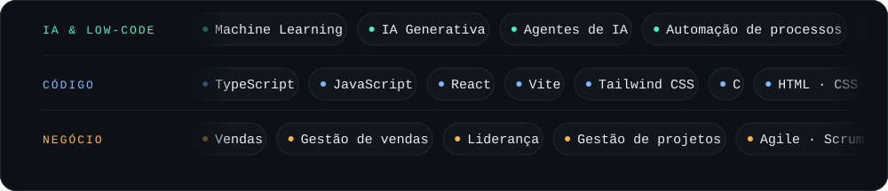

 

## Olá, sou o Bruno 👋

Co-fundador e **Chief Sales Officer da [Flowix](https://flowix.pt)**, uma agência de **IA e automação** em Viseu que ajuda PMEs a eliminar tarefas manuais repetitivas, para que as equipas se foquem no que tem valor.

Combino uma base técnica sólida (passei dois anos na **Deloitte** como Consultant & Developer) com visão comercial: o meu trabalho é traduzir soluções tecnológicas complexas em valor real para quem as usa. Sou ainda **Embaixador EY** e fui reconhecido como **Top 1 Portugal no programa 2025/26**.

 

## Percurso

 

## Projetos

<table>
<tr>
<td width="50%"></td>
<td width="50%"></td>
</tr>
<tr>
<td width="50%"></td>
<td width="50%"></td>
</tr>
</table>

## Competências

## Certificações

## Atividade

<picture>
  <source media="(prefers-color-scheme: dark)" srcset="https://raw.githubusercontent.com/BrunoXJX/BrunoXJX/output/github-snake-dark.svg"/>
  <source media="(prefers-color-scheme: light)" srcset="https://raw.githubusercontent.com/BrunoXJX/BrunoXJX/output/github-snake.svg"/>
  
</picture>

 

